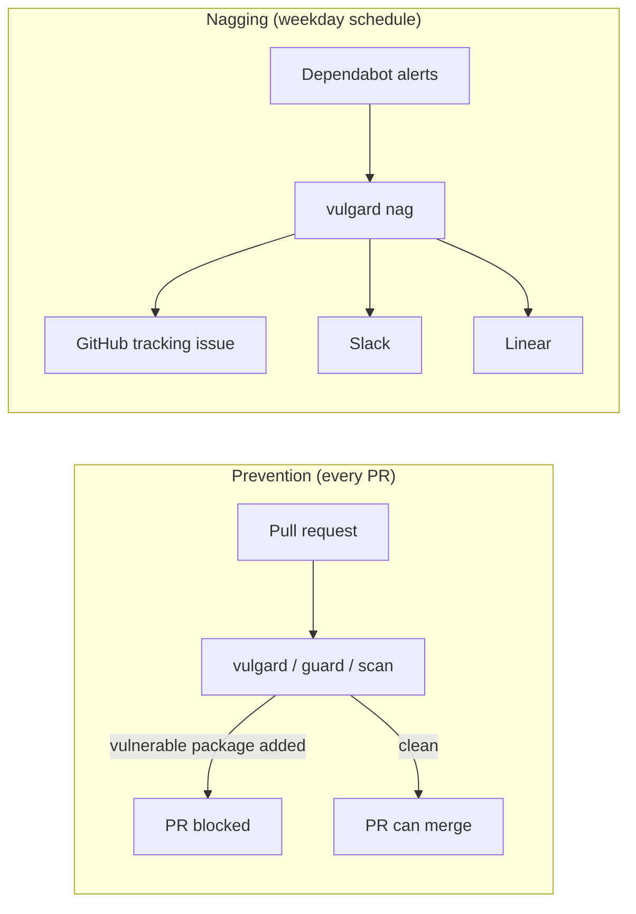

# How vulgard works

This guide explains vulgard from the ground up. It assumes you know Git, GitHub pull requests,
and a little Python, and nothing else. If you only want setup steps, the
[README](../README.md) has them.

vulgard also tracks deployments nobody has updated in a while. That part has its own guide,
[How stale deployments work](stale-deployments.md), which builds on this one.

If you're here because vulgard pinged you, these short guides tell you what to do:

- [Fix the alerts on a vulgard tracking issue](guides/fix-vulnerability-alerts.md)
- [Respond to a stale-deployments issue](guides/respond-to-stale-deployments.md)
- [Troubleshooting](guides/troubleshooting.md)

## The problem

Almost every project depends on open-source packages, and those packages sometimes have
security holes. When a hole becomes public, it gets an ID and a severity, and GitHub starts
warning every repo that uses the affected version.

GitHub's tool for this is **Dependabot**. It does two things:

- It opens a **Dependabot alert** on the repo: "you use `lodash` 4.17.20, which has a known
  vulnerability, and 4.17.21 fixes it." Alerts live under the repo's *Security* tab.
- It often opens a **Dependabot pull request** that bumps the package to the fixed version.

The tooling works. The people part is where it breaks down. Alerts sit in a tab nobody looks
at, PRs wait for a review that never comes, and nobody can say which of the 400 open alerts
across the company actually matter. vulgard is the part that makes humans act.

## Words you'll see

| Term | Meaning |
|---|---|
| Advisory | The public write-up of a vulnerability. It has an ID like `GHSA-xxxx-xxxx-xxxx` (GitHub's) and often a `CVE-2024-12345` (the industry-wide ID). |
| Severity | How bad the vulnerability is: critical, high, medium, or low. Set by the advisory. |
| SLA | Short for "service level agreement". Here it means the number of days a team has to fix an alert, based on severity. A critical gets 7 days by default. |
| Deadline | The date the alert opened plus its SLA days. |
| Overdue | Past the deadline and still open. |
| KEV | CISA's [Known Exploited Vulnerabilities](https://www.cisa.gov/known-exploited-vulnerabilities-catalog) list: vulnerabilities attackers are using right now. vulgard treats these as the most urgent, whatever their severity. |
| Owner | The person or team responsible for a repo, for example `@jlee` or `@acme/payments`. |
| `CODEOWNERS` | A file in a repo that says who owns which paths. vulgard reads its catch-all `*` line to find the repo's owners. |
| Reusable workflow | A GitHub Actions workflow that other repos can call, so the logic lives in one place. |
| Ruleset | An org-level GitHub setting that can require a check to pass before a PR merges. |
| Dry run | Run the tool and print what it *would* do, without changing anything. vulgard does this unless you pass `--apply`. |

## The two halves

vulgard attacks the problem from two sides.

**1. Stop new vulnerabilities from getting in (prevention).** vulgard adds a check called
`vulgard / guard / scan` to every repo. It runs on each pull request and fails if the PR
adds a package with a known vulnerability. An org ruleset makes the check required, so the PR
can't merge while it fails.

**2. Clean up the ones already there (nagging).** Once a day on weekdays, vulgard looks at
every open alert in the org, works out which ones are late, and tells the owners through a
GitHub issue, Slack, and Linear. It keeps reminding them until the alerts are gone.

It also makes cleanup cheaper. It configures Dependabot to bundle small updates into one PR
per ecosystem. Repos that opt in also auto-merge those PRs when CI passes. Fewer PRs and less
clicking means more of them get merged.



## The four commands

vulgard is a Python command-line tool. Every command reads `vulgard.yml` for settings.

| Command | What it does | How often |
|---|---|---|
| `vulgard report` | Prints a table of open alerts and deadlines per repo. Changes nothing. `--topic stale` lists stale deployments instead. | Whenever you're curious |
| `vulgard rollout` | Opens a PR in each repo adding the Dependabot config and the check workflow. `--lifecycle` adds the stale-deployments workflow instead. | Once, then again for new repos |
| `vulgard enforce` | Creates the org ruleset that makes the check required. | After rollout PRs merge |
| `vulgard nag` | Updates tracking issues, pings owners, escalates, and posts to Slack and Linear. | Weekdays at 15:00 UTC, from GitHub Actions |

`rollout`, `enforce`, and `nag` are dry runs unless you add `--apply`. Always look at the dry
run first.

`nag` handles one or more **topics**: vulnerabilities, and, when `deployments.enabled` is on,
stale deployments. Each topic has its own tracking issue per repo, and they all share the same
machinery for issues, reminders, escalation, Slack and Linear. This guide follows the
vulnerabilities topic.

## Rollout: getting every repo set up

`vulgard rollout` goes through each repo in the org and, for each one:

1. Skips it if it's archived, a fork, or already has an open rollout PR.
2. Lists the repo's files and spots package manifests: `package.json` means npm, `go.mod`
   means Go, a `Dockerfile` means Docker, and so on (see `MANIFESTS` in `rollout.py`). It
   ignores vendored folders like `node_modules/`.
3. Generates `.github/dependabot.yml` for those ecosystems, unless the repo already has one.
   The file tells Dependabot to group minor and patch updates into one PR per ecosystem.
4. Generates `.github/workflows/vulgard.yml`, a short workflow that calls reusable
   workflows living in the vulgard repo:
   - `guard.yml` is the PR check that blocks vulnerable packages. Its job is `scan`, so on a
     PR it shows up as `vulgard / guard / scan` (the caller's name, the job that calls
     `guard.yml`, then the job inside it).
   - `automerge.yml` is only called in repos listed in `rollout.auto_merge`, which is empty
     by default. It approves Dependabot's minor and patch PRs and turns on GitHub's
     auto-merge, so they merge as soon as required checks pass. Major version bumps are left
     for a human, because they're more likely to break things. Its check is
     `vulgard / automerge / approve`, and it shows as *skipped* on PRs Dependabot didn't open.
5. Turns on Dependabot alerts and security updates for the repo, and opens a PR with the new
   files.

Because the real logic lives in the vulgard repo, changing the check later means editing one
file, not 200.

## Enforce: making the check required

A check that can be ignored will be ignored. `vulgard enforce` creates one org ruleset named
*"vulgard: block vulnerable dependencies"*. It requires `guard / scan` to pass
on each repo's default branch.

It only covers repos that already have the workflow file. If it required the check in a repo
without the workflow, the check would never run, and every PR in that repo would wait forever.
So re-run `enforce` as more rollout PRs merge.

## Nag: the daily loop

This is the core of vulgard. The scheduled workflow `.github/workflows/nag.yml` runs
`vulgard nag --apply --slack --linear`. Here's what one run does, in order.

### Step 1: gather data

From GitHub it fetches:

- every open Dependabot alert in the org (one API call per page of 100),
- every open Dependabot PR, with its CI status, whether it has merge conflicts, and whether
  it's a draft,
- each repo's owners: first from `owners:` in `vulgard.yml`, then from the `*` line in
  `CODEOWNERS`, then from `default_owners`.

It also downloads the CISA KEV list.

### Step 2: evaluate each alert

For every alert, vulgard works out:

- **Is it excused?** If an entry under `exceptions:` in `vulgard.yml` matches it and hasn't
  expired, the alert moves to an "accepted risk" list and gets no deadline.
- **Its deadline.** The date it opened plus `sla_days` for its severity. If its CVE is on the
  KEV list, the SLA drops to 3 days.
- **Its status.** *Overdue* if past the deadline, *due soon* if within 5 days of it,
  otherwise *ok*.
- **Its fix PR.** If an open Dependabot PR bumps the same package, they're linked, so the
  issue can say "fix ready in #88".

And for every Dependabot PR:

- **Ready**: CI passed, no conflicts, not a draft, and open for at least 2 days. The 2 days
  give auto-merge (in repos that opted in) a chance to handle it first. A ready PR that's still open is waiting on a
  person, and that person should hear about it.
- **Stale**: open for 14 days or more.

This all happens in `policy.py`. It's pure logic with no network calls, which makes it easy
to test.

### Step 3: decide what to say

Each repo gets one GitHub issue labeled `vulgard`, called the **tracking issue**. vulgard
decides, per repo, what to do with it:

| Situation | Decision |
|---|---|
| No open alerts or stale PRs, and no tracking issue | Nothing |
| No open alerts or stale PRs, but a tracking issue is open | Comment "all resolved, thanks" and close it |
| Open alerts, no tracking issue yet | Create one, assigned to the owners and mentioning them |
| Open alerts, and the last tracking issue was closed | Reopen it, so its history stays in one place |
| Open alerts and an existing tracking issue | Rewrite its description with the current list |

Rewriting a description doesn't notify anyone. **Comments** do, so vulgard is careful about
when it comments. It only comments when something changed:

- an alert just went overdue,
- a Dependabot PR just became ready,
- an alert needs escalating (see below), or
- it's been 7 days since the last ping and something is still overdue, ready, or stale.

If none of those happened, the issue gets a fresh description and nobody's phone buzzes. This
matters: a bot that pings every day gets muted, and then it's useless.

**Escalation** pulls in the people listed under `escalation.mentions`, usually a security
lead. An alert escalates once, when it's critical or high and at least 7 days overdue. A KEV
alert escalates as soon as it's overdue at all.

This step is `plan_repo` in `vulns.py`. Its output is a `RepoPlan` (in `plan.py`) that lists
the issue operation, the comments to post, and which alerts and PRs are new.

### Step 4: remember what was already said

To know that an alert *just* went overdue, vulgard has to remember what was overdue
yesterday. It has no database. Instead it hides a small JSON blob at the bottom of the
tracking issue's description, inside an HTML comment, so GitHub doesn't show it:

```html
<!-- vulgard-state {"escalated": [12], "last_reminder": "2026-11-02T15:00:00+00:00",
  "linear": {"id": "…", "identifier": "PAY-42", "url": "…", "digest": "3f9c…"},
  "overdue": [12, 15], "ready_prs": [88]} -->
```

Each field means:

- `overdue` holds the alert numbers that were overdue last run. An overdue alert not in this
  list is *newly* overdue.
- `escalated` holds alerts already escalated, so each one escalates only once.
- `ready_prs` holds PRs that were already ready, so each one pings only once.
- `last_reminder` is when owners were last pinged, for the 7-day reminder.
- `linear` points at the matching Linear issue, so vulgard updates the same one each time.

Next run, vulgard reads this back (`TrackingState.from_body` in `plan.py`), compares it with
the fresh data, and writes the new version. The issue body *is* the database.

### Step 5: write to Linear, then GitHub

For each repo, vulgard:

1. **Syncs Linear** (`linear.py`). It creates or updates a Linear issue in the owning team,
   with priority and due date taken from the worst alert. If someone closed the Linear issue
   while alerts are still open, it reopens it with a comment. It skips the update when
   nothing changed, by comparing a short hash (the `digest`) of what it would write.
2. **Writes the GitHub tracking issue** with the final description, which includes the link
   to the Linear issue, then posts any comments.
3. If the Linear issue is new, **attaches the GitHub issue link** to it.

Linear goes first so the GitHub issue can be written once with the Linear link already in it.

### Step 6: Slack

After all repos are done, vulgard (`slack.py`) groups everything that pinged someone and
sends:

- one message per team channel, listing that team's repos,
- one DM per individual owner, covering all their repos,
- one message to the escalation channel, if anything escalated,
- a leaderboard in `slack.default_channel`, the org-wide channel such as `#engineering`. It
  ranks teams by alerts fixed in the last 7 days and by alerts past deadline, lists the worst
  repos, and names anyone who dismissed a critical or high alert without writing a reason.
  Teams are named, not pinged, so the whole channel isn't notified.

Grouping means a person gets one message per run, not one per alert.

## Following one alert through a month

Say a **high** severity alert opens on `payments-api` on November 1. High alerts get 30 days,
so the deadline is December 1.

| Date | What vulgard does |
|---|---|
| Nov 2 | First run that sees the alert. No tracking issue yet, so it creates one, assigned to `@jlee` and mentioning `@acme/payments`. The team channel gets "new tracking issue". |
| Nov 3 to Nov 25 | Updates the issue description each run. No comments, no pings. |
| Nov 26 | The alert moves into the "Due soon" section, 5 days before its deadline. Still no ping. |
| Dec 2 | The alert is past its deadline. vulgard comments "1 alert just went past its fix deadline", mentions the owners, and posts to Slack. |
| Dec 3 to Dec 7 | Nothing new, and the last ping was less than 7 days ago, so no comments. |
| Dec 8 | The alert is 7 days overdue. vulgard escalates: it mentions the security lead on the issue, comments on the Linear issue, and posts to `#security-escalations`. That comment also restarts the 7-day reminder clock. |
| Dec 15 | Still open, and 7 days since the last ping, so vulgard posts a reminder. |
| Dec 16 | Dependabot's fix PR merges and GitHub closes the alert. vulgard sees no open alerts, comments "all resolved, thanks", closes the tracking issue, and closes the Linear issue. |

If the CVE had been on the KEV list, the deadline would have been November 4, and vulgard
would have escalated on November 5.

## Silencing an alert the right way

Sometimes an alert doesn't apply, for example when the vulnerable function is never called.
There are two honest ways to say so:

- **Dismiss it in GitHub** with a reason. This is permanent. The Slack leaderboard names anyone
  who dismisses a critical or high alert without writing a comment, so dismissals stay
  visible.
- **Add an exception** to `vulgard.yml`. It must have a reason and an expiry date. When it
  expires, the alert comes back:

  ```yaml
  exceptions:
    - repo: payments-api
      advisory: GHSA-xxxx-xxxx-xxxx
      reason: Not reachable from user input; see SEC-123
      expires: 2027-03-31
  ```

Closing the tracking issue by hand doesn't help. vulgard reopens it on the next run.

## Running it on your laptop

You don't need a GitHub token to try vulgard. The repo includes a fake org in
`examples/demo-org.json`:

```bash
uv sync
V="uv run vulgard --config examples/vulgard.yml --fixtures examples/demo-org.json"
$V report                  # the table of repos and deadlines
$V nag --slack --linear    # what it would post, using fake Slack and Linear
```

`--fixtures` swaps the real GitHub, Slack, and Linear clients for in-memory fakes from
`fixtures.py`. The fake org's dates are written like `"@-19d"`, meaning "19 days ago", so the
demo always shows a mix of overdue and fresh alerts.

## Reading the code

The code is in `src/vulgard/`. Read it in this order, which follows a `nag` run:

1. **`cli.py`** parses the command line, builds the clients, and runs each topic.
2. **`topics.py`** has one runner per topic. `run_vulns` is the one this guide follows.
3. **`vulns.py`** holds the vulnerabilities topic. `collect()` fetches alerts and PRs through
   **`github.py`**, a thin wrapper around GitHub's REST and GraphQL APIs. `plan_repo()` decides
   what to do for one repo.
4. **`policy.py`** turns raw alerts and PRs into `Alert`, `DependabotPR`, and `RepoReport`
   objects with deadlines, statuses, and ready or stale flags. Start with `evaluate()`.
5. **`plan.py`** defines the decision types shared by every topic: `RepoPlan`, the issue
   operation (`IssueOp`), and the hidden state (`TrackingState`).
6. **`nag.py`** is the engine. `track()` carries out the plans: it writes tracking issues and
   comments and syncs Linear, for every topic.
7. **`render.py`** turns reports and plans into the markdown you see in issues and comments.
8. **`linear.py`** and **`slack.py`** hold the integrations.
9. **`kev.py`** downloads the CISA list. **`repos.py`** picks which repos to look at and finds
   their owners. **`rollout.py`** and **`enforce.py`** implement the other two commands.
   **`config.py`** loads `vulgard.yml` and rejects unknown keys, so a typo fails loudly instead
   of being ignored.

The stale-deployments modules are covered in
[How stale deployments work](stale-deployments.md#reading-the-code).

A pattern to notice: deciding and doing are kept apart. `policy.py` and `plan_repo()` only
compute. They never call an API. The network calls happen in `nag.track()`, `linear.py`, and
`slack.py`. That's why most tests in `tests/test_vulgard.py` can check behavior by building a
plan from fake data and looking at it, with no mocks.

## Making a change

1. Change the code and add or update a test. Vulnerability tests are in
   `tests/test_vulgard.py`. Most of them build a report with the `alert()` and `pr()` helpers,
   call `plan_repo()`, and check the result. Stale-deployment tests are in `tests/test_stale.py`,
   `tests/test_estate.py`, and `tests/test_lifecycle.py`.
2. If your change affects what vulgard writes, look at the demo output:
   `$V nag --slack --linear`.
3. Push and open a PR. CI runs two jobs. `test` runs `ruff check` (lint), `pytest`, and dry
   runs of `report` and `nag` against the demo org. `types` runs `mypy`, which checks the type
   annotations. Read a failing job's log in the PR's *Checks* tab.

## Common questions

**Why did nobody get pinged today?** Probably because nothing changed. vulgard only comments
when an alert newly goes overdue, a PR newly becomes ready, something escalates, or a week has
passed. Run `vulgard nag` without `--apply` to see what it would do.

**Why did the tracking issue reopen after I closed it?** Alerts are still open, so the next
run reopens it. Fix the alerts, dismiss them with a reason, or add an exception.

**Why didn't the issue get assigned to my team?** GitHub only lets issues be assigned to
people, not teams. Teams are mentioned instead.

**Where did the Slack message go?** vulgard looks up the channel by exact repo name, then by
repo glob (such as `payments-*`), then by each owner, then falls back to
`slack.default_channel`. Check `slack.channels` in `vulgard.yml`.

**Can I edit the tracking issue?** Comments are fine. Edits to the description get
overwritten on the next run, because vulgard rewrites it from current data.
